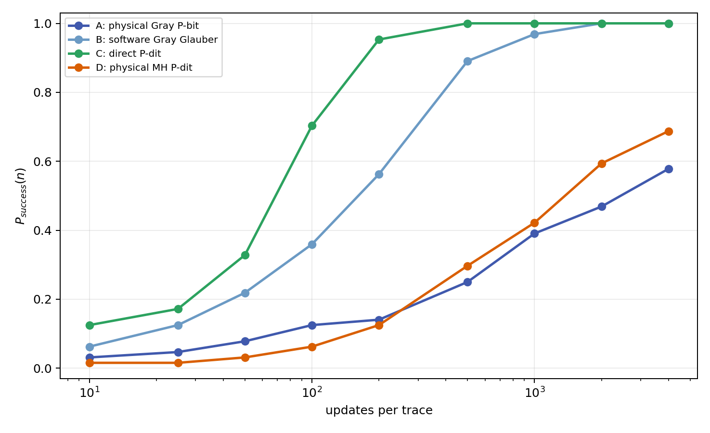
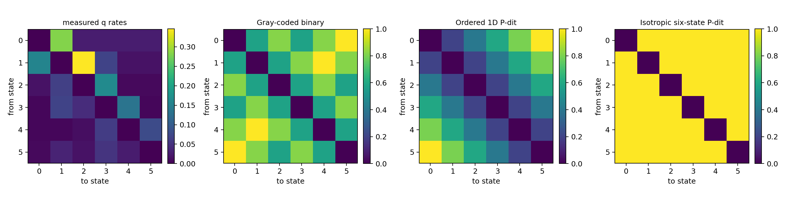
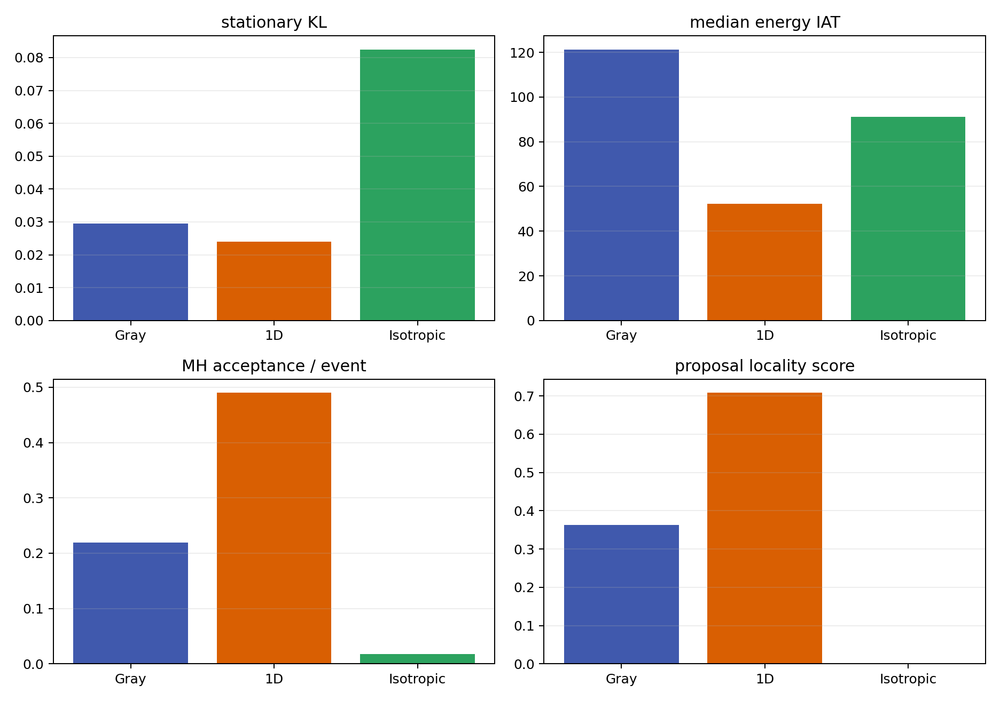

# sMTJ Annealing Accelerator

基于 stochastic magnetic tunnel junction（sMTJ）实测时间序列的随机计算实验仓库。项目覆盖连续信号预处理、离散 K-state 建模、p-bit/P-dit 更新、Ising/QUBO 组合优化，以及 P0/P1 两阶段算法改进。

当前主线是把器件的多状态随机动力学从“随机数来源”提升为可验证的计算 proposal：

- **P0 — Direct P-dit**：取消 Gray code 和 one-hot penalty，直接使用分类变量，并修复离散状态重采样产生虚假中间状态的问题。
- **P0 benchmark**：统一比较 physical Gray P-bit、software Gray Glauber、direct P-dit、physical MH P-dit 四种求解器。
- **P0 TSP**：在 TSP 中比较原始 one-hot Ising 路线和始终保持合法排列的直接 P-dit 路线。
- **P1 — Empirical-transition MH**：使用实测退出率和转移矩阵形成

  \[
  q_{kl}=r_kP_{kl},
  \qquad
  A_{kl}=\min\left(1,e^{-\beta\Delta E_{kl}}\frac{q_{lk}}{q_{kl}}\right),
  \]

  并在同一个 K=6 profile 上比较 Gray-coded binary、ordered 1D P-dit 和 isotropic six-state P-dit。

## 仓库结构

```text
.
├── README.md
├── requirements.txt
├── data/                         # 原始 Excel 测量数据
│   ├── simulated annealing.xlsx
│   ├── simulated annealing_bad.xlsx
│   └── random number.xlsx
├── src/                          # 全部 Python 源码
│   ├── project_paths.py          # 统一 data/results/docs 路径
│   ├── mtj_p0_direct_pdit_partition.py
│   ├── mtj_p0_four_solver_benchmark.py
│   ├── mtj_p0_pdit_tsp_comparison.py
│   ├── mtj_p1_empirical_transition_mh.py
│   └── mtj_*.py                  # 基础 SA、p-bit、K-state 和应用脚本
├── results/                      # 已提交的可复现实验快照
│   ├── mtj_p0_direct_pdit_output/
│   ├── mtj_p0_four_solver_output/
│   ├── mtj_p0_pdit_tsp_comparison_output/
│   ├── mtj_p1_empirical_transition_mh_output/
│   ├── mtj_ising_application_demos_output/
│   └── ...
└── docs/                         # 报告与本地打包材料
    └── mtj_ising_application_results.md
```

`src/project_paths.py` 使用脚本自身位置确定仓库根目录，因此下面的命令可从任意工作目录执行。所有新结果都会写入仓库的 `results/`。

## 安装

需要 Python 3.10 或更高版本。

```bash
git clone https://github.com/loopist666/sMTJ-annealing-accelerator.git
cd sMTJ-annealing-accelerator
python3 -m venv .venv
source .venv/bin/activate
python -m pip install --upgrade pip
python -m pip install -r requirements.txt
```

Windows PowerShell 激活环境：

```powershell
.\.venv\Scripts\Activate.ps1
```

## P0：Direct P-dit

### 直接分类三分区

```bash
python src/mtj_p0_direct_pdit_partition.py
```

主要改动：

1. 一个 D-partition 变量直接表示为一个 D-state categorical P-dit。
2. 不再使用 Gray code 或 one-hot penalty。
3. 每个 dwell segment 至少保留一个离散样本，保持 dwell 顺序和边界。
4. 输出重采样验证、分区成功率和更新 checkpoint。

结果位于 [`results/mtj_p0_direct_pdit_output/`](results/mtj_p0_direct_pdit_output/)。

### 四求解器统一对照

```bash
python src/mtj_p0_four_solver_benchmark.py
```

默认在可完全枚举的三分区问题上运行 64 条独立 trace，每条 4000 次更新，并报告：

- \(P_{success}(n)\)、trials/time-to-solution；
- 平均和中位 energy gap、首次命中更新数；
- valid-state ratio、trace 间方差；
- integrated autocorrelation time；
- 与精确 Boltzmann 分布的 KL divergence；
- empirical detailed-balance flux error；
- 物理随机样本消耗。

结果位于 [`results/mtj_p0_four_solver_output/`](results/mtj_p0_four_solver_output/)。



### TSP 对照

```bash
python src/mtj_p0_pdit_tsp_comparison.py
```

该实验比较原始 one-hot Ising TSP 与直接 permutation P-dit；后者的所有中间状态都是合法路线。结果位于 [`results/mtj_p0_pdit_tsp_comparison_output/`](results/mtj_p0_pdit_tsp_comparison_output/)。

## P1：Empirical-transition MH

```bash
python src/mtj_p1_empirical_transition_mh.py
```

P1 固定使用 selected-curve 的 K=6 profile，将实测 \(r_k\) 和 \(P_{kl}\) 共同用于状态对 proposal，而不是仅使用总退出率作为 hazard gate。默认配置为 64 条 trace、每条 8000 次更新，并精确枚举 \(6^4=1296\) 个状态。

输出包括：

- 三种状态几何的 proposal locality 和 rate-distance correlation；
- MH acceptance、成功率和首次命中；
- KL、total variation、IAT 和 effective samples；
- 理论与经验 detailed-balance error；
- 实测 \(q\) 矩阵与三种几何距离矩阵。

当前器件转移图与 **ordered 1D P-dit** 最匹配：其 proposal locality、MH 接受率和混合效率均优于 Gray 和 isotropic 解释。

结果位于 [`results/mtj_p1_empirical_transition_mh_output/`](results/mtj_p1_empirical_transition_mh_output/)。





## 其他实验

| 脚本 | 功能 | 输出目录 |
|---|---|---|
| `src/mtj_sa_demo.py` | good/bad 曲线对齐与传统 SA | `results/mtj_sa_output/` |
| `src/mtj_hardware_sa_demo.py` | MTJ hardware-SA profile 与 Ising demo | `results/mtj_hardware_sa_output/` |
| `src/mtj_hardware_sa_multistate_demo.py` | 多状态 hardware-SA | `results/mtj_hardware_sa_multistate_output/` |
| `src/mtj_hardware_sa_benchmark.py` | 多 Ising 实例 benchmark | `results/mtj_benchmark_output/` |
| `src/mtj_multistate_pbit_demo.py` | 多状态 p-bit 更新 | `results/mtj_multistate_pbit_output/` |
| `src/mtj_multistate_pbit_sweep.py` | K-state 参数与实例 sweep | `results/mtj_multistate_sweep_output/` |
| `src/mtj_physical_sa_demo.py` | dwell/hazard 物理退火分析 | `results/mtj_physical_sa_output/` |
| `src/mtj_physical_kstate_demo.py` | GMM/HMM K-state 提取与优化 | `results/mtj_physical_kstate_output/` |
| `src/mtj_physical_kstate_selected_curve.py` | selected-curve K-state 稳定性分析 | `results/mtj_physical_kstate_selected_curve_output/` |
| `src/mtj_ising_application_demos.py` | TSP、Max-Cut、Portfolio QUBO/Ising | `results/mtj_ising_application_demos_output/` |

应用实验的详细说明见 [`docs/mtj_ising_application_results.md`](docs/mtj_ising_application_results.md)。

## 推荐复现顺序

```bash
python src/mtj_sa_demo.py
python src/mtj_physical_kstate_demo.py
python src/mtj_p0_direct_pdit_partition.py
python src/mtj_p0_four_solver_benchmark.py
python src/mtj_p0_pdit_tsp_comparison.py
python src/mtj_p1_empirical_transition_mh.py
python src/mtj_ising_application_demos.py
```

## 数据与结果管理

- `data/` 中的 Excel 文件是实验输入，脚本不会覆盖它们。
- `results/` 中保存当前论文和汇报所用的 CSV、JSON、PNG 快照。
- `docs/*.zip`、虚拟环境、Python cache 和临时文件由 `.gitignore` 排除。
- 重新运行脚本会更新相应 `results/<experiment>/`，提交前应检查参数和 diff。

## 许可证与引用

仓库目前未声明开源许可证；公开复用前请联系仓库维护者确认许可范围。

P-dit 方法参考：Christian Duffee *et al.*, “P-dits: Probabilistic d-dimensional bits for extended-variable probabilistic computing,” *Physical Review Applied* **24**, 044077 (2025), DOI: [10.1103/4ngx-cmz7](https://doi.org/10.1103/4ngx-cmz7).
