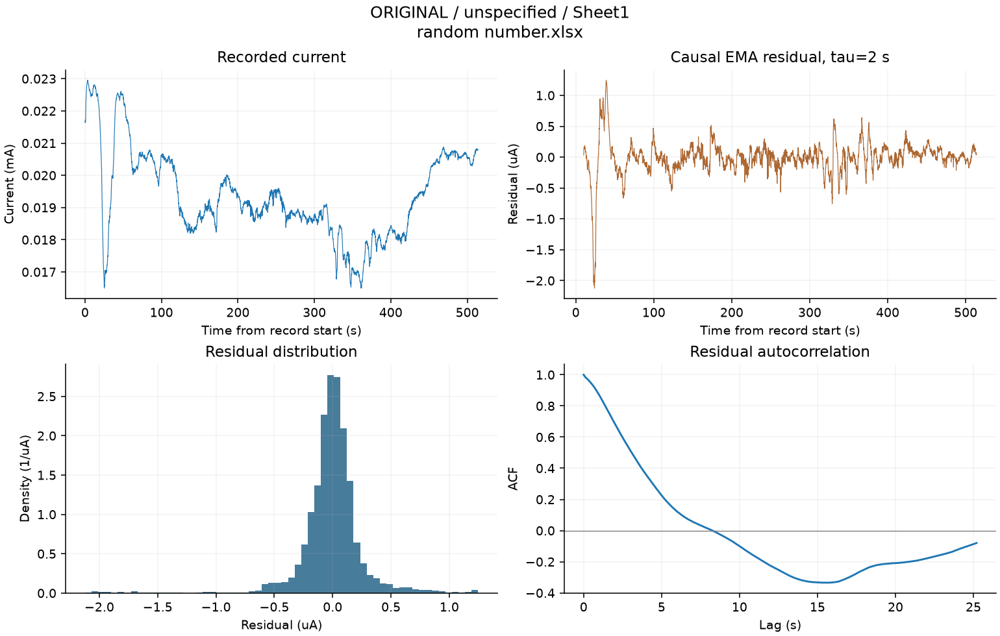
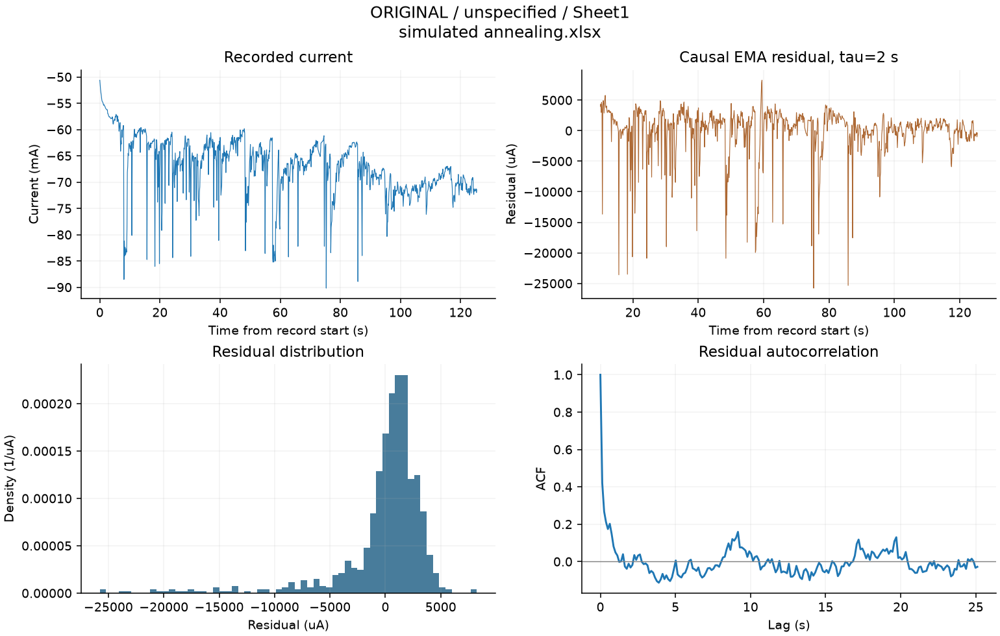
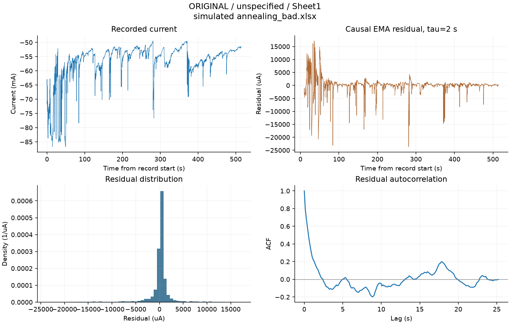

# ORIGINAL 测量统计

记录数：3。全部记录均列入；表中 σ 为 2 s 因果去基线后、距记录起点 10 s 以后的标准差。

列定义和计算方法见 [方法说明](../../docs/methods.md)，实验条件见 [协议记录](../../docs/protocols.md)。

| 组 / 器件 | 工作表 | 偏压中位数 V | 平均 I mA | 原始 σ μA | 残差 σ μA | τeff s | 时长 s |
|---|---|---:|---:|---:|---:|---:|---:|
| original / unspecified | random number.xlsx / Sheet1 | 未记录 | 0.019365 | 1.3469 | 0.27513 | 3.3345 | 513.95 |
| original / unspecified | simulated annealing.xlsx / Sheet1 | -2 | -66.983 | 5566.4 | 4026.6 | 0.26174 | 125.38 |
| original / unspecified | simulated annealing_bad.xlsx / Sheet1 | -2.3 | -56.663 | 6822 | 2996 | 0.71902 | 513.96 |

## 逐记录曲线

### random number.xlsx / Sheet1

原始工作簿：[random number.xlsx](../../data/raw/original/random%20number.xlsx)；器件：unspecified。

### simulated annealing.xlsx / Sheet1

原始工作簿：[simulated annealing.xlsx](../../data/raw/original/simulated%20annealing.xlsx)；器件：unspecified。

### simulated annealing_bad.xlsx / Sheet1

原始工作簿：[simulated annealing_bad.xlsx](../../data/raw/original/simulated%20annealing_bad.xlsx)；器件：unspecified。

