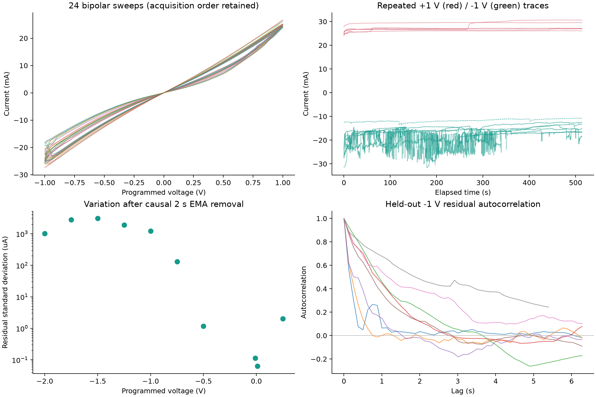
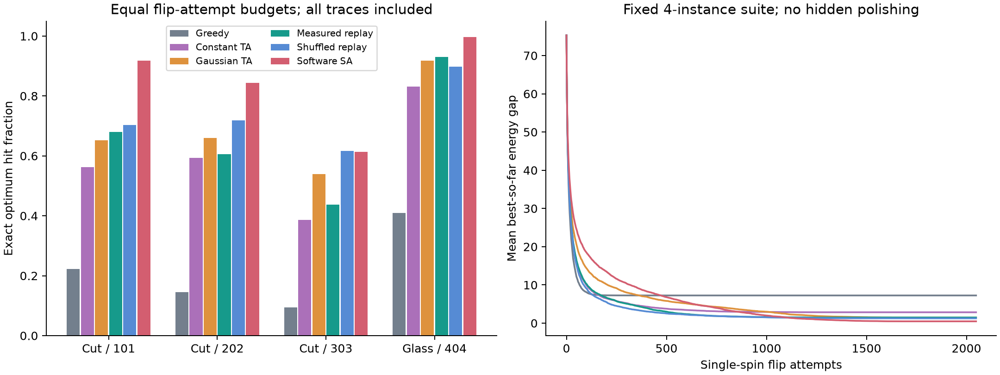
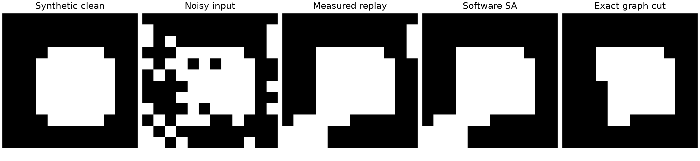

# R4C5：单通道实测扰动驱动的软件 Ising demo

## 结论与边界

项目主线改为 **单通道电流回放 + 软件阈值接受退火**。自旋、J、h、节点调度、能量计算和阈值包络均在软件；器件记录只提供一维连续扰动。无需可编程多状态、p-bit 概率曲线、分区读出或物理耦合网络。
本结果是有限记录的离线软件实验，不是硬件 Ising 机、独立真随机数认证、Boltzmann 采样或加速优势证明。

在固定四问题套件中，实测原序回放的平均精确解命中率为 **66.3%**，贪心为 21.8%、打乱回放为 73.4%、软件 SA 为 **84.3%**。当前支持“实测扰动可以参与优化”，不支持“器件相关性或器件方案优于成熟软件算法”。

## 数据核查

- 共 49 条测量记录：25 条 I–t、24 条 I–V，来自 5 个工作簿。锁文件和 ZIP 重复件未导入。
- 电流 AI 按 A、AV 按 V、Time 按 s 读取；Settings 显示电压为 Programmed，因此 V×I 只是按设定电压估计的器件功耗。Settings 中的 Compliance 为 0.105 A。
- 按原行顺序处理，依据 AV 识别偏压；`160R4C5-0.25VA1V` 名称带负号，但 AV 实为 +0.25 V。
- 含 dead 的记录保留在数据诊断中，按名称预先排除求解器主基准；不根据解题成绩筛曲线。
- 主基准使用所有 8 条合格的固定 −1 V 记录。它们来自同一个 R4C5，重复种子不是独立器件重复。
- 没有磁场、温度、空载/等效电阻噪声对照，当前只能称为测量链路中的电流涨落，不能单独归因于磁热翻转。

`fast -1v` 的 Δt 中位数为 0.107849 s，采样率 9.272 Hz；普通记录约 7.97 Hz。当前数据不能验证 ns/µs 翻转速率。

| 记录 | AV (V) | 平均 I (mA) | 原始 σ (µA) | 2 s 因果残差 σ (µA) | 残差 lag-1 | τeff (s) |
|---|---:|---:|---:|---:|---:|---:|
| 160R4C5-0.25V | -0.25 | -8.0965 | 12.209 | 0.854 | 0.481 | 0.317 |
| 160R4C50.01VA1V | 0.01 | 0.1188 | 0.800 | 0.063 | 0.465 | 0.359 |
| 160R4C5-0.01VA1V | -0.01 | -0.1134 | 0.751 | 0.113 | 0.470 | 0.391 |
| 160R4C5-0.25VA1V | 0.25 | 2.4313 | 31.730 | 2.020 | 0.606 | 0.640 |
| 160R4C5-2VA1V | -2.00 | -50.1942 | 6728.587 | 1023.988 | 0.656 | 0.750 |
| 160R4C5-1.75VA1V | -1.75 | -46.7922 | 10465.049 | 2805.265 | 0.863 | 0.836 |
| 160R4C5-1.5VA1V | -1.50 | -48.9834 | 5237.423 | 3072.118 | 0.622 | 0.485 |
| 160R4C5-1.25VA1V | -1.25 | -25.3078 | 5545.808 | 1895.269 | 0.796 | 0.698 |
| 160R4C5-1VA1V | -1.00 | -16.0021 | 2784.375 | 1225.194 | 0.651 | 0.532 |
| 160R4C5-0.5VA1V | -0.50 | -14.4565 | 7.106 | 1.163 | 0.463 | 0.332 |
| 160R4C5-0.75VA1V | -0.75 | -18.3339 | 1453.224 | 131.012 | 0.888 | 0.906 |
| 160R4C51V6 | 1.00 | 29.4552 | 165.093 | 13.630 | 0.870 | 4.882 |
| 160R4C5-1V6 | -1.00 | -18.5249 | 3275.793 | 2063.375 | 0.471 | 0.208 |
| 160R4C51V5 | 1.00 | 25.9973 | 185.139 | 28.188 | 0.904 | 0.729 |
| 160R4C5-1V5 | -1.00 | -16.7379 | 929.776 | 311.437 | 0.887 | 1.113 |
| 160R4C51V4 | 1.00 | 26.5701 | 170.894 | 21.183 | 0.940 | 2.600 |
| 160R4C5-1V4 | -1.00 | -16.1320 | 2006.361 | 390.562 | 0.898 | 1.128 |
| 160R4C51V3 | 1.00 | 28.4268 | 1804.654 | 80.093 | 0.995 | 5.053 |
| 160R4C5-1V3 | -1.00 | -15.5287 | 1247.542 | 570.469 | 0.661 | 0.558 |
| 160R4C51V2 | 1.00 | 27.0260 | 195.065 | 13.191 | 0.883 | 5.932 |
| 160R4C5-1V2 | -1.00 | -18.5774 | 3383.610 | 824.268 | 0.855 | 0.820 |
| 160R4C51V | 1.00 | 26.9591 | 548.848 | 61.030 | 0.980 | 3.620 |
| 160R4C5-1Vdead | -1.00 | -11.7419 | 594.547 | 82.548 | 0.882 | 1.270 |
| 160R4C5-1V | -1.00 | -16.5275 | 4631.537 | 1639.109 | 0.785 | 0.747 |
| 160R4C5-1Vfast | -1.00 | -12.4783 | 2607.643 | 653.902 | 0.673 | 0.732 |

在循环记录中，+1 V 的 2 s 残差标准差范围为 13.2–80.1 µA，−1 V 为 311.4–2063.4 µA。负偏置下更强的突发涨落是选择 −1 V 做扰动回放的依据。它提示极性与历史相关的传输机制，但测试顺序尚未随机化，不能据此宣称极性可独立控制随机性。

τeff 仅为给定采样与滤波条件下、ACF 首次非正前的积分摘要；不是本征驻留时间。`filter_sensitivity.csv` 同时报 0.5、2、10 s 基线常数下的结果。不同偏压记录的历史与时刻不同，不据此建立可编程温度码本。



## 新求解器

```text
E(s) = -Σ(i<j) J_ij s_i s_j - Σi h_i s_i
ΔE_i = 2 s_i (Σj J_ij s_j + h_i)
r_k = I_k - b_(k-1)
b_k = b_(k-1) + [1-exp(-Δt_k/τ)] r_k
z_k = (r_k - μ_train) / σ_train
A_k = gain × 2 median_i sqrt(Σj J_ij² + h_i²) × (1-k/(M-1))²
接受翻转当且仅当 ΔE_i ≤ A_k |z_k|
```

求解器 EMA 时间常数为 2.0 s。前 40% 为标定段，丢弃前 5τ 的滤波启动段；后 60% 为回放段。μ、σ 只由标定段计算。滤波因果进行，不读取未来样本、不插值、不提取 K-state；每次翻转尝试消耗一个连续样本，不循环回放。不同软件 run 可以重用同一记录，必须按这一限制解释统计。

A 的量纲是算法能量；gain 和退火包络是软件设置，未映射到实际电压或热力学温度。单路扰动按时间依次用于软件自旋，节点初态与选择由软件 PRNG 提供。此方法是优化启发式，相关阈值一般不满足 Boltzmann 详细平衡。

## 对照与结果

固定 3 个 16 节点加权 Max-Cut 与 1 个带局域场的 16 自旋 spin-glass。每个实例完整枚举 65,536 个状态得到精确基准。每条记录 32 个软件种子、每次 2048 次翻转尝试、gain=1.5。每组方法共用初态、节点顺序和原始片段，无提前结束或额外局部抛光。

- Greedy：阈值为 0。
- Constant TA：与该片段平均 |z| 匹配的恒定扰动因子，仍使用同一冷却包络。
- Gaussian TA：与该片段 RMS 匹配的软件高斯扰动。
- Measured replay / Shuffled：完全相同的样本集合，仅时间顺序不同。
- Software SA：标准 Metropolis 接受，使用软件 Exp(1) 阈值；T=A。
高斯和常量匹配使用完整测试片段，仅作离线消融，不能伪称为在线校准。当前没有为各方法分别调到最优，结果不构成算法排名。

| 问题 | 方法 | 精确解命中 | 平均能量差 |
|---|---|---:|---:|
| maxcut16_101 | Greedy | 22.3% | 4.7266 |
| maxcut16_101 | Constant TA | 56.2% | 1.9766 |
| maxcut16_101 | Gaussian TA | 65.2% | 1.1250 |
| maxcut16_101 | Measured replay | 68.0% | 0.9844 |
| maxcut16_101 | Shuffled replay | 70.3% | 0.9922 |
| maxcut16_101 | Software SA | 91.8% | 0.1719 |
| maxcut16_202 | Greedy | 14.5% | 10.7500 |
| maxcut16_202 | Constant TA | 59.4% | 4.4922 |
| maxcut16_202 | Gaussian TA | 66.0% | 2.2500 |
| maxcut16_202 | Measured replay | 60.5% | 2.0234 |
| maxcut16_202 | Shuffled replay | 71.9% | 1.7422 |
| maxcut16_202 | Software SA | 84.4% | 0.4141 |
| maxcut16_303 | Greedy | 9.4% | 8.5938 |
| maxcut16_303 | Constant TA | 38.7% | 3.7812 |
| maxcut16_303 | Gaussian TA | 53.9% | 2.0703 |
| maxcut16_303 | Measured replay | 43.8% | 2.5312 |
| maxcut16_303 | Shuffled replay | 61.7% | 1.7578 |
| maxcut16_303 | Software SA | 61.3% | 1.2891 |
| spin_glass16_404 | Greedy | 41.0% | 4.9141 |
| spin_glass16_404 | Constant TA | 83.2% | 1.1367 |
| spin_glass16_404 | Gaussian TA | 91.8% | 0.4922 |
| spin_glass16_404 | Measured replay | 93.0% | 0.3789 |
| spin_glass16_404 | Shuffled replay | 89.8% | 0.5664 |
| spin_glass16_404 | Software SA | 99.6% | 0.0195 |



配对差值以每个软件种子跨记录/问题平均后 bootstrap；区间只反映软件种子变动，不反映器件间可重复性：

| 差值 | 平均 gap 差 | 软件种子 95% 区间 |
|---|---:|---:|
| replay minus shuffled | 0.2148 | [0.0136, 0.4151] |
| replay minus gaussian | -0.0049 | [-0.2217, 0.2012] |
| replay minus constant | -1.3672 | [-1.6241, -1.1074] |
| replay minus sa | 1.0059 | [0.8203, 1.2090] |
| replay minus greedy | -5.7666 | [-6.1231, -5.4111] |

负值有利于原序回放。即使优于某个对照，也只能说明这组记录、预算和超参数下的结果，不能推导普遍优势。

## 第二应用：二值图像去噪

用合成 12×12 图像建立铁磁近邻耦合与观测局域场；实测序列驱动同一个求解器。另用精确 s–t min-cut 求出该能量模型的最优解。该图不是器件显微图，也不是物理分区读出。

输入像素准确率 80.6%；实测回放 87.5%，能量 gap 3.500；精确 MAP 的像素准确率 95.1%。降低模型能量不保证每个真实像素都正确。



## 器件结构与应用判断

提供的元素叠图显示 Fe/Ni 富集区域以及 Ba/Sr 的空间分布；仅此不能确定化学相、隧穿势垒、电极连接、磁各向异性、10⁷ 可寻址自旋或耦合 J。本文只将其作为非均匀复合结构的线索，不将柱/颗粒直接当作 Ising 自旋。

1. **优先验证：单通道模拟扰动协处理器。** 固定工作点采样，经 AC 耦合/数字基线去除后送入 CPU/FPGA 阈值接受搜索。新增价值应通过实测回放对比打乱、高斯、常阈值、SA 来检验；不依赖器件存储自旋。
2. **事件驱动搜索。** 大电流突变可触发更大的软件邻域或重启。需把触发频率、计算量与 PRNG 事件流匹配，防止把更大搜索预算误当成器件优势。当前仅为待测方向。
3. **历史相关动态 / 时序 reservoir。** 正负偏置下的漂移和路径依赖可启发单节点时序特征处理。需先做随机化脉冲序列、重复响应与 fading-memory 检验；不能由自发漂移直接声称可训练存储。
4. **状态与健康监测。** 波动幅度、相关性和慢漂移可用于检测工作点变化；要有外部温度/磁场/损伤标签才能验证传感含义。

## 下一轮最有辨别力的实验

- 同一工作点至少多条独立重复，随机化电压测试顺序；记录预处理、恢复等待、采样积分时间、量程和实际端电压。
- 空载、短路/等效电阻与仪器基线对照；磁场/温度扫描用于区分磁性、电阻通道和测量链路的贡献。
- 提高采样带宽并测 anti-alias / ADC 链路；先定位 PSD 与相关时间，再决定合理采样率。
- 固定偏置、仅软件改增益完成第一版实时闭环。比较相同翻转尝试数和相同墙钟下的解质量，计入 ADC、软件、数据传输和采样等待。
- 分区读出不是此路线的前置条件；若将来主张物理自旋网络，仍必须补充寻址、J 可控性、读出和物理能量映射实验。

## 时间与能量不能混淆

当前 2048 个不同样本的采集跨度约 220.8–256.9 s。Python 对已存数组的运行时间不是器件求解时间。`runs.csv` 分别记录两者，并记录设定 V×I 的片段积分；该积分未包含外围，也不是测得的闭环 energy-to-solution。另需计入前 40% 的标定采集与启动等待；打乱方法还需要离线缓冲。

## 参考方法

- Dueck & Scheuer, Threshold accepting, J. Computational Physics 90, 161–175 (1990): https://doi.org/10.1016/0021-9991(90)90201-B
- Böhm et al., Noise-injected analog Ising machines, Nature Communications 13, 5847 (2022): https://www.nature.com/articles/s41467-022-33441-3 。仅作噪声参与计算的概念参照；其中的硬件条件和采样结论不转移到 R4C5。
- Boykov & Kolmogorov, min-cut/max-flow energy minimization (2004), author publications: https://pub.ista.ac.at/~vnk/publications.html

## 预处理与软件增益敏感性

附加固定网格：EMA τ∈{0.5, 2, 10} s，gain∈{0.5, 1.5, 3}，每条记录 8 个种子，均为 2048 次尝试。下面报告跨固定四问题的平均 gap；没有用此网格挑选主结果。

| τ (s) | gain | 原序 gap | 打乱 gap | 软件 SA gap |
|---:|---:|---:|---:|---:|
| 0.5 | 0.5 | 2.926 | 2.906 | 0.281 |
| 0.5 | 1.5 | 1.805 | 1.492 | 0.551 |
| 0.5 | 3.0 | 1.770 | 0.977 | 0.734 |
| 2.0 | 0.5 | 2.301 | 2.238 | 0.281 |
| 2.0 | 1.5 | 1.371 | 1.180 | 0.551 |
| 2.0 | 3.0 | 1.238 | 0.750 | 0.734 |
| 10.0 | 0.5 | 1.633 | 1.281 | 0.281 |
| 10.0 | 1.5 | 1.051 | 0.625 | 0.551 |
| 10.0 | 3.0 | 1.168 | 0.555 | 0.734 |

该网格说明预处理会改变算法表现；这里的 τ 是软件滤波旋钮，不是器件可编程的物理相关时间。完整六方法结果见 `solver_sensitivity.csv`。
